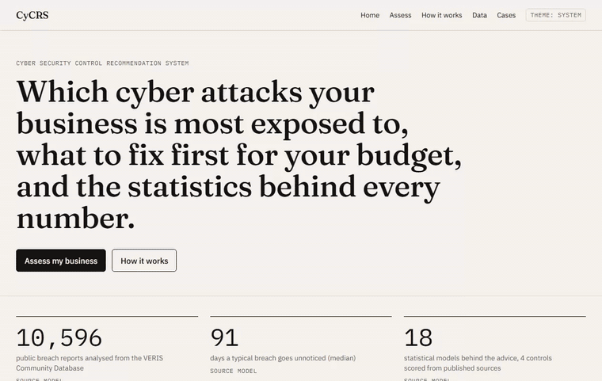
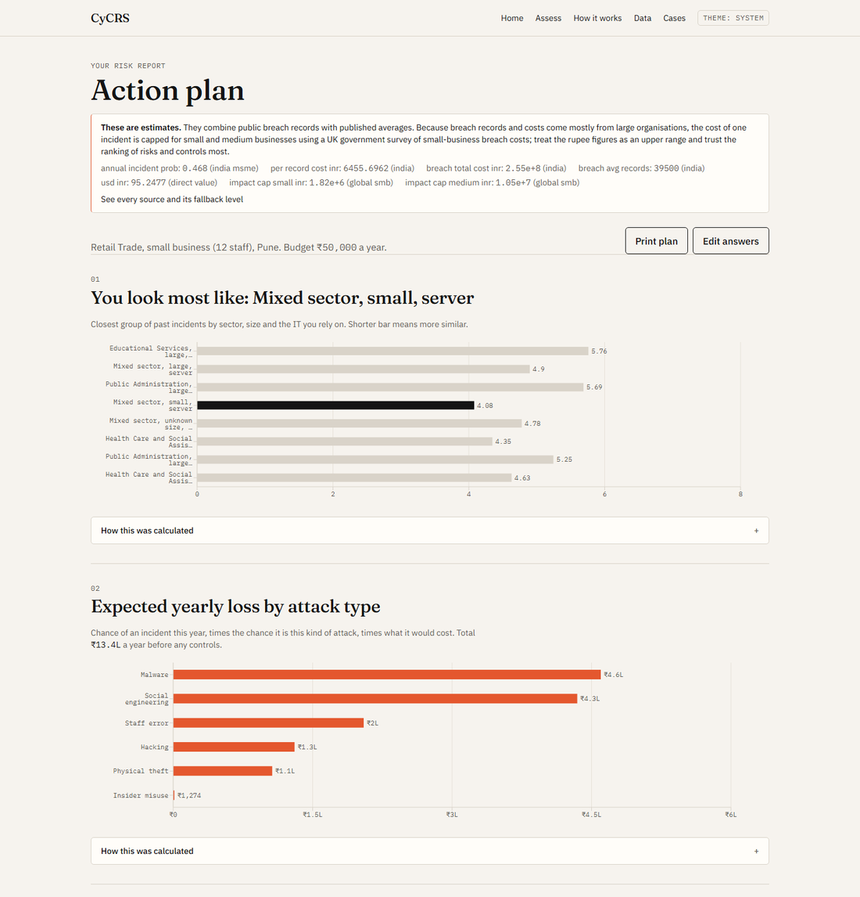
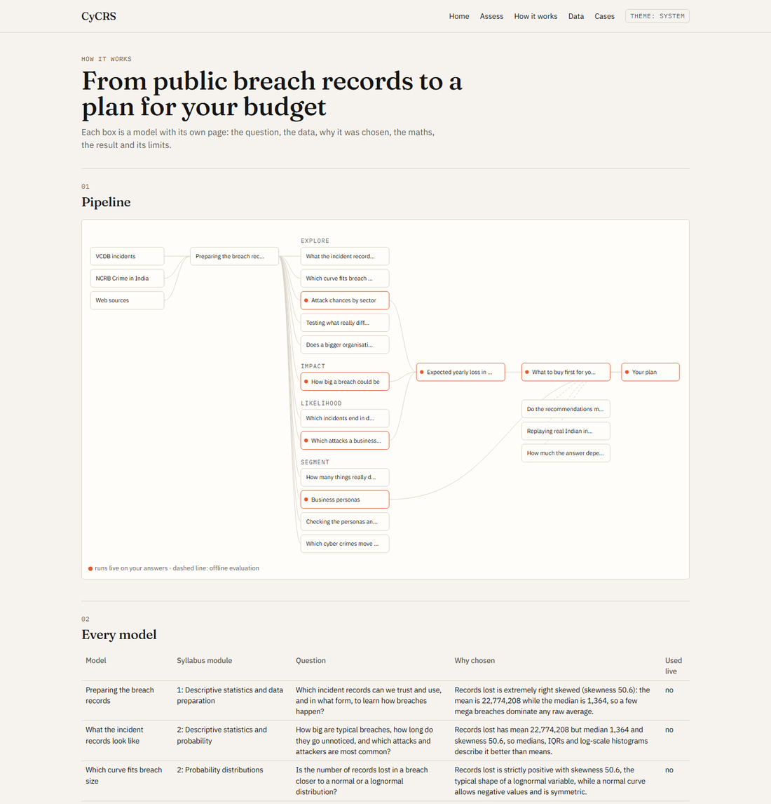
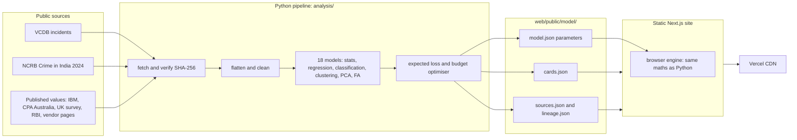

# CyCRS

**Cyber Security Control Recommendation System.** Tells an Indian small business which cyber attacks it is most exposed to, which security controls to buy first for its budget in rupees, and shows the statistics behind every number.

Live site: _coming soon (Vercel)_



| Results for a small retail shop | How it works |
| --- | --- |
|  |  |

## How it works



Your answers never leave the browser. The site is a static export: the recommendation runs in your browser from the exported parameters, with a full trace of every step.

## Run it

```bash
git clone https://github.com/PR0XCITY/CyCRS.git
cd CyCRS/web
npm ci
npm run dev
```

Rerun the analysis (Python 3.11): `pip install -r requirements.txt && cd analysis && python -m src.fetch.vcdb && for n in notebooks/0*.py; do python "$n"; done`

## Results

Measured on 2026-10-14; details in [docs/metrics.md](docs/metrics.md) and checks in [docs/audit.md](docs/audit.md).

| Metric | Value |
| --- | --- |
| Recommendation latency in the browser (p95, 1,000 runs) | 0.088 ms |
| JavaScript per page (gzip, before lazy charts) | 173 to 202 KB |
| Lighthouse, local mobile run (performance / accessibility) | `/` 96 to 97 / 100, `/results` 81 to 84 / 100, model page 87 / 100 |
| Best breach classifier | Decision tree, 5-fold CV AUC 0.826 (test AUC 0.850) |
| Attack-type models (test AUC) | physical 0.892, hacking 0.865, malware 0.840, error 0.741, social 0.738, misuse 0.690 |
| Coverage hit rate on 3,105 held-out incidents | 20.9% vs 20.9% for the 3 most common controls |
| Greedy optimiser vs exhaustive search | 0.00% gap on 5 reference profiles |
| Syllabus techniques with a model card and page | 16 of 16 |

The hit rate cannot show personalisation yet: only 4 of 12 controls have a published effectiveness and price, so every plan's top 3 equals the baseline.

## Data sources

- [VERIS Community Database](https://github.com/vz-risk/VCDB): 10,596 validated incident reports (main modelling data).
- [NCRB Crime in India 2024](https://www.ncrb.gov.in/crime-in-india-table-content?year=2024): state-wise cyber crime tables 9A.1 to 9A.3.
- Published values, each with URL, access date and an excerpt: IBM Cost of a Data Breach 2026 (India), CPA Australia Asia-Pacific Small Business Survey 2025-2026, UK Cyber security breaches survey 2025/2026, RBI reference rates, Microsoft, AV-Comparatives, Sophos, Google, Bitwarden and NCSC pages. Full list: [analysis/data/sources/SOURCES.md](analysis/data/sources/SOURCES.md).

## Limitations

- VCDB comes from public reports, so large and US organisations are over-represented; Indian small businesses are not in the training data.
- Rupee amounts are estimates. One incident's cost is capped for small and medium businesses using a UK survey, because no Indian small-business figure was found; treat rupee figures as an upper range and trust the ranking most.
- Only 4 of 12 controls are ranked; the other 8 lack a published effectiveness or price and are listed as not ranked, with the reason.
- Probabilities describe what happens if an incident occurs; the yearly chance of an incident comes from one survey of Indian small businesses.
- Personas are only partly stable (adjusted Rand index 0.44 between K-means and Ward).

## Security

No server, database or accounts; strict content security policy and headers in `web/vercel.json`. See [THREAT_MODEL.md](THREAT_MODEL.md) and [SECURITY.md](SECURITY.md).
